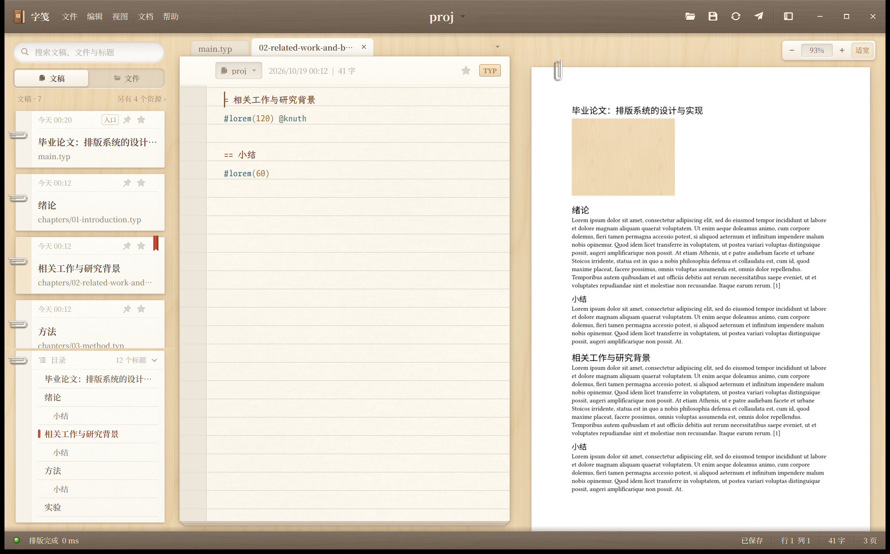
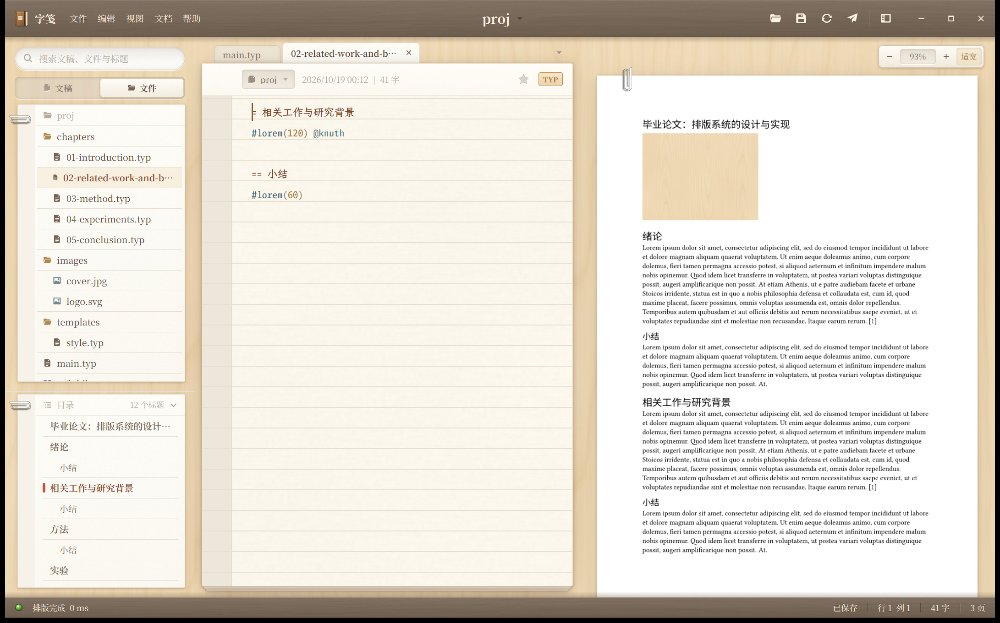
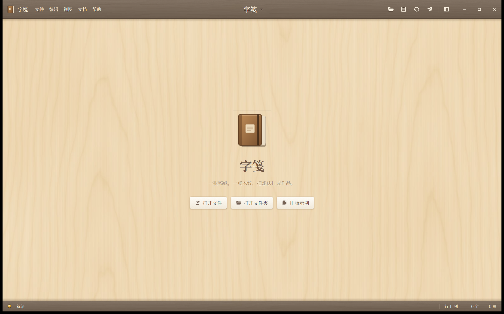

# 字笺 · 拟物主题（锤子便签风格）

参照锤子便签的三张截图，把桌面编辑器做成“一张书桌”：
胡桃木顶栏压着桦木桌面，桌上放着便签卡片、一本横线稿纸和排好的纸页。







`smartisan-concept.png` 是上一版（扁平暖色）的生成设计稿，仅作历史参考。

## 配色（从截图取样）

| 元素 | 颜色 | 出处 |
|---|---|---|
| 胡桃木顶栏 | `#736252`，上沿高光、下沿 `#4d3e31` | 截图 1 顶栏 |
| 桦木桌面 | `#f0ddbc`，纹理 `#f6e5c8`→`#e3c697` | 截图 1 背景 |
| 便签卡片 | 头部 `#fdfcf7`，正文 `#fbf8f1`，装订条 `#f6f2e9` | 截图 1 卡片 |
| 稿纸 | `#fbf7ec`，横线 `#e6dfd2`，页边 `#ede7db` | 截图 3 |
| 墨色 | 正文 `#574033`，时间戳 `#b3aba1` | 截图 1、3 |
| 橙色标签 | 边框/文字 `#b98c57` | 截图 3 “RTF” |

全部集中在 [`src/theme.rs`](../src/theme.rs)。

## 拟物细节对照

| 锤子便签 | 字笺 |
|---|---|
| 木纹顶栏、浮雕白字、带阴影的白色图标 | `walnut_bar` + `embossed` 文字 + `bar_glyph` 双层图标；悬停时按钮“凹进”木头 |
| 标题旁的凹陷小三角 | 标题按钮旁的凹陷三角，点开切换文稿 |
| 顶栏投在桌面上的阴影 | `bar_cast_shadow`，状态栏同样向上投影 |
| 桦木桌面（教堂纹） | `textures/birch.jpg`：按“年轮圆柱 + 倾斜锯切面”物理模型生成 |
| 凹陷的胶囊搜索框 | `inset_pill`：内阴影 + 下沿白色高光；可搜索文稿与标题 |
| 便签卡片：左侧装订条、回形针、时间戳、图钉、星标、分隔线 | 每个 `.typ` 文件一张卡片：图钉 = 设为预览主文件，星标 = 置顶；当前文稿挂红色丝带书签，未保存显示橙色墨点 |
| 编辑页：文件夹凹槽、“日期 \| 字数”、星标、RTF 标签 | 稿纸页眉：项目凹槽、修改时间 \| 字数、星标、`TYP` 标签 |
| 横线稿纸 + 左侧页边 | 编辑器背景透明，下面用 canvas 画页边条、双线和横线，随编辑器滚动对齐每一行 |
| — | 打开的文件是插在稿纸顶边的索引页签；稿纸下面露出两张纸，像一本便笺本 |
| — | 预览页躺在桌面上，首页别着竖向回形针，页码刻在木头上 |
| — | 胡桃木状态栏：编译指示灯（绿/琥珀/红）+ 浮雕文字 |
| — | 提示是一张别着回形针的黄色便条，3.5 秒后收起 |

字体：界面与卡片用 Noto Serif SC（接近锤子便签的宋体气质），稿纸用 LXGW Bright Code（中英等宽）。

## 素材

- 纹理：[`assets/textures`](../assets/textures)，由 [`assets/gen/textures.py`](../assets/gen/textures.py) 生成（numpy + Pillow）。
- 图标：[`assets/skin`](../assets/skin)，由 [`assets/gen/skin_svgs.py`](../assets/gen/skin_svgs.py) 生成。
  彩色 SVG（回形针、图钉、星标、丝带、指示灯、笔记本图标）按 3 倍尺寸绘制，
  因为 GPUI 按 SVG 自身尺寸栅格化彩色图片；`g_*.svg` 为单色字形，由 GPUI 着色。
- 运行时由 [`src/assets.rs`](../src/assets.rs) 内嵌，并叠加在 gpui-kit 自带图标之上。

重新生成：

```powershell
cd gpui-app/assets/gen
python textures.py ../textures
python skin_svgs.py ../skin
```

## 针对设计审查的改进（2026-10-19）

| 审查项 | 处理 |
|---|---|
| P1 重开示例破坏编辑状态 | 会话状态抽到 [`src/workspace.rs`](../src/workspace.rs)（缓冲区、标签顺序、当前文稿、代次），可单测；打开同一项目或项目内文件不再重置会话；“同路径直接返回”只在缓冲区仍存在时生效 |
| 未保存内容会丢失 | 切换项目、关闭标签、关闭窗口都会先弹出稿纸风格的确认框：保存并继续 / 不保存 / 取消（Enter / Esc）；不保存时把编译器中的内存覆盖恢复为磁盘内容 |
| 文件树被卡片取代 | 侧栏顶部“文稿 / 文件”压印切换；“文件”是完整目录树（图片、参考文献、配置均可见），文本类文件可直接编辑，图片在资源管理器中定位；搜索同时过滤卡片、目录树与大纲 |
| 大纲被挤到列表底部 | 大纲卡独立成区、独立滚动，可拖动分界线调整高度，标题栏可折叠 |
| 默认预览裁切 | 新增“适宽”模式并设为默认，窗口或栏宽变化时自动重算；“实际大小”保持独立（Ctrl+0 / Ctrl+9） |
| 标签无溢出处理 | 标签限宽省略、横向滚动、切换时滚到可见；溢出菜单列出全部文稿；标签可关闭（× / Ctrl+W），未保存时显示墨点 |
| 设主文件阻塞界面 | 图钉切换移到后台线程获取编译锁；再次点击取消固定；未固定时自动入口显示“入口”标记 |
| 过期结果覆盖新项目 | 编译、扫描、固定结果都带工作区代次，切换项目后到达的旧结果被丢弃 |
| 控件语义不一致 | 项目凹槽是真正的项目菜单；页眉星标可点击，与卡片同一动作；徽标显示实际扩展名 |
| 路径对比度低 | 卡片路径改用 `PATH_INK #8a7864`，时间戳保持次要 |
| 行号/行距不可调 | 视图菜单：“紧凑代码模式（行号）”、增大/减小/默认字号；稿纸行距随字号缩放 |
| 字体硬编码 | 启动时从已安装字体中按优先级选择宋体与等宽字体，缺失时回退到系统字体 |
| 测试未覆盖会话 | 新增 7 个工作区单测（含 P1 回归）、项目扫描/目录过滤测试、素材内嵌完整性测试 |

## 针对产品交付审查的改进（2026-10-19 第二轮）

| 审查项 | 处理 | 验证 |
|---|---|---|
| P1 A→B→A 预览与导出串文档 | 缓存键 `DocKey` = 入口 + 项目根 + 覆盖内容指纹 + 依赖文件版本（mtime+大小）；导出前用当前文本重新确认编译，`export_pdf` 拒绝导出非当前入口的文档 | `switching_back_to_an_unchanged_entry_shows_that_entry`、`export_refuses_a_document_from_another_entry` |
| P1 外部修改依赖仍显示旧内容 | 依赖版本变化使缓存失效；每 1.5 秒检查依赖，变化即重新编译；F5 为强制编译 | `external_edits_to_dependencies_are_picked_up`、`forced_compile_bypasses_the_cache`；原生窗口验证 |
| 切换入口时未保存的其他文件被磁盘内容替代 | 新建 World 时应用全部覆盖内容；依赖只在编译真正读取时记录 | `unsaved_edits_reach_a_freshly_created_world` |
| 保存覆盖外部修改 | 保存前比对磁盘版本，不一致时弹出冲突对话框（用我的版本覆盖 / 载入磁盘版本 / 取消） | 原生窗口验证 |
| 保存不是原子替换 | 同目录临时文件 → `sync_all` → 替换；只读、失败时清理临时文件 | `files.rs` 5 个测试 |
| 崩溃后无草稿恢复 | 停止输入约 1.2 秒写恢复日志；强制结束后再启动提供恢复 | `recovery.rs` 测试；强杀进程后恢复的原生窗口验证 |
| 切标签清空撤销与位置 | 每个文档一个 `EditorState`；外部重载用 `replace_all` 保留撤销 | 原生窗口验证光标保留 |
| 保存失败信息只显示 3.5 秒 | 稿纸顶部持久提示条（重试保存 / 另存为），标签与状态栏同步标红 | 只读文件的原生窗口验证 |
| 外部修改的已打开文件 | 无未保存修改：自动载入；有未保存修改：提示条选择；被删除：提示保存会重建 | `outside_changes_are_detected_and_resolved`；原生窗口验证 |
| 新建 / 另存为 / 全部保存 / 最近项目 | 文件菜单与快捷键；欢迎页与菜单列出最近项目 | — |
| 项目文件管理 | 文件树右键：新建文稿、新建文件夹、重命名（打开的文档随之改名）、移到回收站（确认，可还原） | `renames_carry_buffers_and_tabs` |
| 查找替换可发现性 | 编辑菜单接入编辑器自带的查找 / 替换；新增项目查找与替换面板（替换进入编辑器、可撤销） | `project_search_finds_matches_in_open_and_disk_text` |
| 模板包 | `@preview` 首次使用自动下载到本机缓存，之后离线可用；错误进入诊断 | `preview_packages_are_downloaded_on_first_use`（需联网，`--ignored`） |
| 持久问题列表 | 状态栏错误/警告数可点击；问题面板按文件:行:列列出，点击定位 | 原生窗口验证 |
| 设置与会话 | `settings.json`：字号、模式、侧栏、星标、最近项目、上次会话；未知字段忽略、缺失字段取默认 | `settings.rs` 测试 |
| 后台编译卡住界面 | 编译时不再持有状态写锁，界面读取不等待编译 | 代码路径 |
| 大文件高亮全量工作 | `Source::edit` 增量重解析，样式只遍历可见范围 | `incremental_edits_match_a_fresh_parse` |
| 覆盖层点击穿透 | 对话框、面板、提示条、缩放控件 `occlude()`，不再误触下层预览跳转 | 原生窗口复现并验证 |
| 可重复构建与追溯 | `scripts/package-windows.ps1`（干净工作区检查、测试、Release、冒烟、ZIP + SHA-256、build-info）；`build.rs` 嵌入提交号与日期；CI 工作流 | 本机完整运行 |
| 诊断与支持 | 本地滚动日志、崩溃报告、“复制诊断信息”（不含文稿内容） | — |
| 文档与声明 | 用户指南（入门、保存与恢复、包、快捷键、常见问题、数据与隐私、更新卸载）、第三方声明、许可证随包分发 | — |

### 代码审查补充（[REVIEW-2026-10-19](REVIEW-2026-10-19.md)）

| 问题 | 处理 | 验证 |
|---|---|---|
| “不保存”后被丢弃的文本仍可能留在编译器里（排队的编译会被下一次取消） | `discard_overlay` 同步把覆盖内容和已保存的 World 换回磁盘文本，再编译当前文稿 | `discarded_overlays_take_effect_without_compiling` |
| 切换项目后，排在编译锁后面的旧编译/固定仍会执行 | 编译器会话号：后台任务取得锁后先比对，已切换则放弃并清除“编译中” | `session_ids_change_on_reset` |
| 缓存命中时警告消失 | 缓存同时保存警告与结构化诊断，命中时原样返回 | `cached_compiles_keep_their_warnings` |
| 输入中光标标记指向错误位置 | `jump_from_offset_live`：编辑器文本与已编译文本一致才给出标记 | `live_jumps_refuse_text_the_compiler_has_not_seen` |
| 非 UTF-8 文件报“找不到” | 报告为编码错误 | — |
| 固定主文件时读不到文件仍以空文本编译 | 提示读取错误并放弃 | — |
| 每次按键都复制全文给编译 | 防抖结束时再读取文本 | — |
| 光标闪烁导致整窗重绘 | 编辑器通知只在光标移动时触发重绘 | — |
| 高倍缩放、超长页面位图过大 | 每页像素密度不超过 4 px/pt，边长不超过 8192 px | `density_is_capped_by_texture_size_and_budget` |
| 渲染失败的页每帧重试 | 失败也记录已尝试的键 | — |
| 预览中的链接和交叉引用无反应 | 网址（http/https/mailto）用系统浏览器打开；交叉引用在预览中标出目标位置 | — |
| 卡片元素 id 按序号，置顶后悬停状态错位 | 改为按路径 | — |
| 扫描期间显示“还没有文稿” | 扫描中显示“正在读取项目…” | — |
| 窗口创建失败时发布版无任何痕迹 | 写入日志后退出 | — |
| `AGENTS.md` 仍写 CodeMirror | 改为 Monaco / `MonacoEditor.ts`，函数索引按实际代码更正 | — |

## 已知限制

- 编译仍在进程内执行，复杂文稿无法中途取消；如需隔离与可取消编译，下一步可评估独立编译进程。
- 未实现自动更新与安装程序（便携 ZIP，手动替换文件夹）；正式公开发布前需代码签名。
- 可访问性（屏幕阅读器语义、高对比度）与多显示器、不同 DPI、显卡的兼容性尚未系统验证。

- GPUI 没有文字阴影，浮雕/压印效果用“同一段文字错开 1px 叠两层”实现。
- 稿纸横线依赖编辑器顶部内边距常量 `EDITOR_TOP_PAD`；若 gpui-kit 调整编辑器内边距需同步。
- 稿纸模式不显示行号（锤子便签也没有），行列号在状态栏；需要行号时切到“紧凑代码模式”。

## 运行

```powershell
cd gpui-app
cargo run -- examples
```
